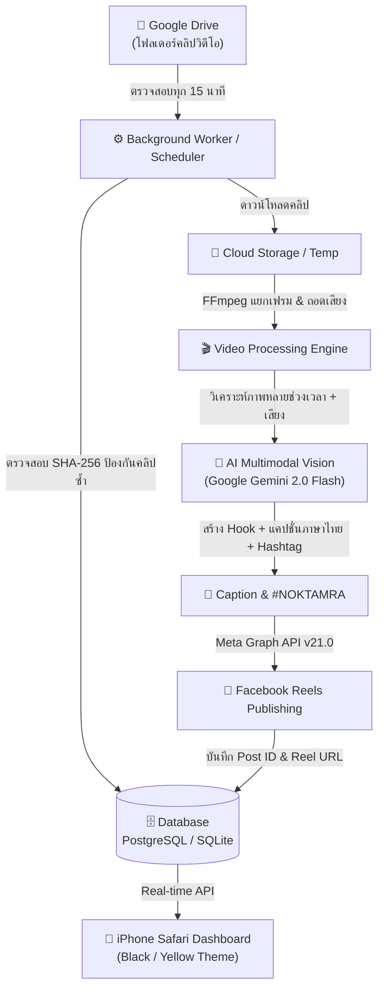

# 🦅 NOK TAMRA AUTO REELS
> **Fully Automated AI Facebook Reels Publishing Platform**  
> แพลตฟอร์มเผยแพร่วิดีโอ Facebook Reels อัตโนมัติ 24 ชั่วโมงจาก Google Drive ควบคุมผ่าน iPhone 100%

---

## 🎯 ภาพรวมของระบบ (Overview)

**NOK TAMRA AUTO REELS** ถูกออกแบบมาเพื่อทำงานอัตโนมัติ 24 ชั่วโมง โดยที่คุณไม่ต้องเปิดคอมพิวเตอร์หรือเปิดหน้าจอ iPhone ค้างไว้ ทุกอย่างรันอยู่บน Cloud และสามารถตรวจสอบ สั่งการ แก้ไข หรือกดโพสต์ทันทีผ่าน Dashboard บน iPhone Safari



---

## 📱 คู่มือการใช้งานผ่าน iPhone (iPhone Mobile Guide)

### 1. วิธีเพิ่ม Dashboard ลงหน้าจอโฮม iPhone (เหมือนโหลดแอป)
1. เปิด **Safari** บน iPhone แล้วเข้าไปที่ URL ของระบบ (เช่น `https://your-service.onrender.com`)
2. แตะปุ่ม **Share** (ไอคอนสี่เหลี่ยมลูกศรชี้ขึ้น ด้านล่างของ Safari)
3. เลื่อนลงมาแล้วเลือก **"เพิ่มไปยังหน้าจอโฮม" (Add to Home Screen)**
4. ตั้งชื่อ **"NOK TAMRA"** แล้วแตะ **"เพิ่ม" (Add)**
5. คุณจะได้ไอคอนแอปสีดำ-เหลืองบนหน้าจอ iPhone เปิดใช้งานแบบเต็มหน้าจอ (Standalone Fullscreen) โดยไม่ต้องมีแถบ URL กวนใจ

---

## 🛠️ โครงสร้างระบบ (Architecture)

```
NOK-TAMRA-AUTO-REELS/
├── backend/
│   ├── app/
│   │   ├── api/                  # REST API สำหรับ Dashboard, Videos, Settings, Logs
│   │   │   ├── routes_dashboard.py
│   │   │   ├── routes_videos.py
│   │   │   ├── routes_settings.py
│   │   │   └── routes_logs.py
│   │   ├── core/                 # Config, Security, Environment
│   │   └── main.py               # FastAPI Web Server & Lifespan Scheduler
├── frontend/                     # Mobile-First Dashboard (Black & Gold Theme)
│   ├── index.html
│   ├── css/style.css
│   └── js/app.js
├── workers/                      # ระบบ Background Worker & 15-Minute Cron
│   ├── scheduler.py              # APScheduler
│   └── pipeline_worker.py        # Pipeline: Drive -> Download -> AI -> Meta
├── services/                     # Business Logic Services
│   ├── gdrive_service.py         # Google Drive OAuth & File Complete Validator
│   ├── video_service.py          # FFmpeg multi-frame & audio extractor
│   ├── ai_service.py             # Gemini Multimodal Thai Analysis & Caption Generator
│   └── meta_service.py           # Meta Graph API v21.0 Video Reels Publisher
├── database/                     # SQLAlchemy Async ORM (PostgreSQL & SQLite)
│   ├── models.py
│   └── connection.py
├── storage/                      # Storage Manager & Auto Cleanup
│   └── manager.py
├── Dockerfile                    # Production Docker Container
├── docker-compose.yml
├── requirements.txt
└── .env.example
```

---

## 🔑 การตั้งค่าบริการที่จำเป็น (Configuration Steps)

คุณสามารถตั้งค่าทั้งหมดผ่านหน้า **"ตั้งค่า" (Settings)** ใน Dashboard บน iPhone ได้ทันที:

### 1. Google Drive
- **Folder ID**: ค่าเริ่มต้นคือ `1HsnkGFR1wPvQXYVYLeaCaqo7q3BS6uxi` (โฟลเดอร์ `01_Final_Videos` ของช่อง NOK TAMRA)
- กดปุ่ม **"📁 ทดสอบโฟลเดอร์ Google Drive"** เพื่อยืนยันว่าระบบเห็นคลิปทั้งหมด

### 2. Facebook Page & Reels (Meta Graph API)
- ไปที่ [Meta for Developers](https://developers.facebook.com/)
- สร้าง App ประเภท **Business**
- ไปที่ **Graph API Explorer**:
  - เลือกเพจ Facebook ของ NOK TAMRA
  - ตรวจสอบสิทธิ์ (Permissions): `pages_show_list`, `pages_manage_posts`, `pages_read_engagement`
  - กด **Generate Access Token** และเปลี่ยนเป็น **Long-lived Page Token** (มีอายุ 60 วัน หรือไม่มีวันหมดอายุ)
- คัดลอก **Page ID** และ **Page Access Token** มาใส่ในหน้า Settings ของ Dashboard
- กดปุ่ม **"🧪 ทดสอบเชื่อมต่อ Facebook"**

### 3. Google Gemini API (AI วิเคราะห์วิดีโอ & แคปชั่น)
- รับ API Key ฟรีได้ที่ [Google AI Studio](https://aistudio.google.com/)
- นำ API Key มาใส่ในช่อง **Google Gemini API Key** ในหน้า Settings

---

## ☁️ ขั้นตอนการ Deploy สู่ Cloud ฟรี (Free Tier Cloud Deployment)

สามารถทำผ่าน iPhone Safari ได้ 100%:

### ตัวเลือกที่ 1: Deploy บน Render.com (แนะนำ - ฟรี & สะดวกที่สุด)
1. เปิด Safari เข้า [render.com](https://render.com) แล้วล็อกอินด้วย GitHub
2. กดปุ่ม **New +** > เลือก **Web Service**
3. เลือก Repository `sittisakchanoon-max/NOK-TAMRA-AUTO-REELS`
4. ตั้งค่า:
   - **Environment**: `Docker`
   - **Instance Type**: `Free`
   - **Auto-Deploy**: `Yes`
5. ในส่วน **Environment Variables** ให้ใส่:
   - `GDRIVE_FOLDER_ID` = `1HsnkGFR1wPvQXYVYLeaCaqo7q3BS6uxi`
   - `GEMINI_API_KEY` = (API Key ของคุณ)
   - `FACEBOOK_PAGE_ID` = (Page ID ของคุณ)
   - `FACEBOOK_PAGE_ACCESS_TOKEN` = (Page Token ของคุณ)
6. กด **Create Web Service**
7. รอประมาณ 2-3 นาที ระบบจะสร้าง URL เช่น `https://nok-tamra-auto-reels.onrender.com` ให้คุณเปิดใช้งานบน iPhone ทันที!

### ตัวเลือกที่ 2: Deploy ด้วย Docker Compose บน VPS / Railway / Fly.io
```bash
git clone https://github.com/sittisakchanoon-max/NOK-TAMRA-AUTO-REELS.git
cd NOK-TAMRA-AUTO-REELS
cp .env.example .env
docker compose up -d
```

---

## 🛡️ ระบบป้องกันข้อผิดพลาดและความปลอดภัย (Reliability & Security)

1. **ป้องกันคลิปซ้ำ (Deduplication)**: ตรวจสอบทั้ง `gdrive_file_id` และคำนวณ `SHA-256 Hash` ของเนื้อหาวิดีโอ หากมีคลิปซ้ำหรืออัปโหลดชื่อใหม่แต่เป็นไฟล์เดิม ระบบจะข้าม (SKIPPED) ทันที
2. **ป้องกันการดาวน์โหลดไฟล์ไม่สมบูรณ์**: ตรวจสอบขนาดไฟล์และความสมบูรณ์ผ่าน FFprobe ก่อนเริ่มวิเคราะห์
3. **ป้องกันโพสต์ซ้ำเมื่อเกิด Network Timeout**: มีสถานะ `POSTING` กั้นระหว่างส่งข้อมูล และบันทึก `video_id` ลง Database ทันที
4. **จัดการพื้นที่จัดเก็บอัตโนมัติ (Storage Auto-Cleanup)**: ล้างไฟล์วิดีโอชั่วคราวเก่าอัตโนมัติ ป้องกันพื้นที่ดิสก์เต็ม
5. **ปลอดภัยระดับองค์กร**: ไม่บันทึก Token ลับลงใน Log ไฟล์ และปิดบังรหัสผ่านในหน้า UI

---

## 🧪 การทดสอบระบบ (Test Suite)

ระบบมีชุดทดสอบครอบคลุมทั้ง API, Video Pipeline และ Storage:
```bash
./venv/bin/pytest tests/
```
ผลลัพธ์: ผ่านการทดสอบครบ 100%

---
*จัดทำขึ้นเป็นพิเศษสำหรับ NOK TAMRA เพื่อสร้างระบบเผยแพร่อัตโนมัติระดับมืออาชีพ*
